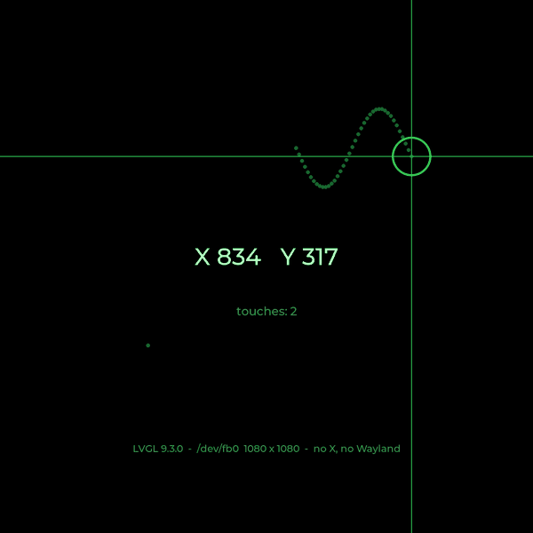

# 3. The touch demo, step by step



Touch the screen and it shows where: crosshairs, a ring under your finger,
the X and Y coordinates in big type, a count of touches, and a trail of
dots as you drag. It's the first thing to get working with any new screen,
because it proves the whole chain: the display mode, the framebuffer, the
touch panel, its scaling, and LVGL.

## Build and run

```
sudo apt install git cmake build-essential
git clone --recurse-submodules https://github.com/va7sdf/lvgl-radar.git
cd lvgl-radar/touch-demo
cmake -B build
cmake --build build -j4
sudo ./build/touch-demo
```

The first build compiles LVGL itself, which takes a few minutes on a
Zero 2; after that, rebuilds take seconds. **Ctrl-C** quits and gives the
text console back.

`--recurse-submodules` matters: LVGL is a *git submodule*, a pointer to a
specific version (9.3.0) of LVGL's own repository. If you cloned without
it, run `git submodule update --init`.

> **IPv6 only?** github.com has no IPv6 address yet, so cloning from a
> network with IPv6 and no IPv4 needs NAT64/DNS64 (chapter 9). Most
> IPv6-only networks, including mobile carriers, provide it.

The demo finds the touch screen itself. To choose a device, name it:

```
sudo ./build/touch-demo /dev/input/by-id/usb-Waveshare_Waveshare_-079-HD-event-if00
```

`sudo` is only there to hide the console cursor (chapter 1). Without it the
demo still runs, with a blinking cursor in the corner.

## Walking through the code

Everything is in [`touch-demo/main.c`](https://github.com/va7sdf/lvgl-radar/blob/main/touch-demo/main.c).
Here are the parts that matter.

### Start LVGL and connect the screen

```c
lv_init();
lv_tick_set_cb(tick_ms);                    // how LVGL tells the time

lv_display_t *disp = lv_linux_fbdev_create();
lv_linux_fbdev_set_file(disp, "/dev/fb0");  // draw here
```

LVGL asks the framebuffer for its size and pixel format, so the same code
works on any screen.

### Connect the touch screen

```c
if (argc > 1)
    lv_evdev_create(LV_INDEV_TYPE_POINTER, argv[1]);   // the one you named
else
    lv_evdev_discovery_start(found_device, NULL);      // find them all
```

*Discovery* watches `/dev/input` and adds every touch screen, mouse and
keyboard it finds, including ones plugged in later. LVGL reads each touch
panel's range from the kernel and scales it to the screen's pixels.

### Build the screen

Widgets are created as children of a parent, here the screen itself:

```c
coords = lv_label_create(scr);
lv_obj_set_style_text_font(coords, &lv_font_montserrat_48, 0);
lv_obj_set_style_text_color(coords, lv_color_hex(0xC8FFD0), 0);
lv_label_set_text(coords, "Touch the screen");
lv_obj_align(coords, LV_ALIGN_CENTER, 0, -20);
```

The crosshairs are two `lv_line` widgets, the ring is a plain object with a
round border, and the trail is 120 small round objects created up front,
hidden, and reused oldest-first. Creating and deleting widgets on every
touch would work too, but reusing them keeps memory steady.

### React to touches

One function handles every touch event on the screen:

```c
lv_obj_add_event_cb(scr, on_touch, LV_EVENT_PRESSED, NULL);
lv_obj_add_event_cb(scr, on_touch, LV_EVENT_PRESSING, NULL);
lv_obj_add_event_cb(scr, on_touch, LV_EVENT_RELEASED, NULL);
```

`PRESSED` is the finger going down, `PRESSING` repeats while it stays down
(and moves), and `RELEASED` is it lifting. Inside, ask where the finger is
and move things there (slightly simplified):

```c
static void on_touch(lv_event_t *e)
{
    lv_point_t p;
    lv_indev_get_point(lv_indev_active(), &p);   // where is the finger?

    if (lv_event_get_code(e) == LV_EVENT_RELEASED) {
        lv_obj_add_flag(ring, LV_OBJ_FLAG_HIDDEN);   // finger up: hide
        return;
    }
    lv_obj_set_pos(ring, p.x - 40, p.y - 40);        // centre the ring
    lv_obj_remove_flag(ring, LV_OBJ_FLAG_HIDDEN);
    lv_label_set_text_fmt(coords, "X %d   Y %d", (int)p.x, (int)p.y);
}
```

Note that nothing here *draws*. Callbacks only change widgets; LVGL works
out which parts of the screen changed and redraws just those, the next
time round the main loop.

### The main loop

```c
for (;;) {
    uint32_t idle = lv_timer_handler();
    usleep((idle > 33 ? 33 : idle) * 1000);
}
```

Capping the sleep at 33 ms means the touch screen is read about 30 times a
second, even when nothing else is due.

## Things to try

- Change the colours (`lv_color_hex(0x...)`) or the font size
  (`lv_font_montserrat_24` or `_48`; the sizes compiled in are set in
  `lv_conf.h`).
- Add a button: `lv_button_create(scr)` with a label child, and an
  `LV_EVENT_CLICKED` callback that clears the trail.
- Run it on another screen: an SPI panel that appears as `/dev/fb1` works
  with `FBDEV=/dev/fb1 sudo ./build/touch-demo`.
