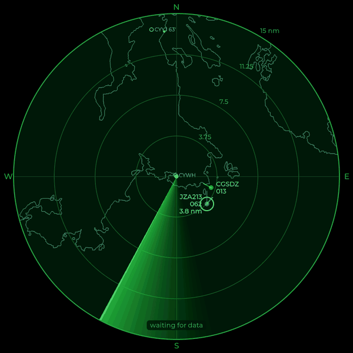

# 6. The map



A plain radar scope is hard to read: is that aircraft over the harbour or
over the hills? A faint outline map underneath answers that at a glance.
It's made for your own position by `make_map.py`, a Python script that
uses only the standard library.

## What's in it

| Layer | Source | Licence |
|---|---|---|
| Shorelines and lakes | [GSHHG](https://www.soest.hawaii.edu/pwessel/gshhg/), full resolution | LGPL |
| Rivers | GSHHG | LGPL |
| Airports, runways, frequencies | [OurAirports](https://ourairports.com/data/) | Public domain |
| VORs and NDBs (navaids) | OurAirports | Public domain |
| Towns and peaks (optional) | [GeoNames](https://www.geonames.org/) | CC BY 4.0 |

> **Lesson learned:** I tried Natural Earth's coastlines first. They're
> lovely for a world map, but at 10 nm the islands around Victoria were
> blobs. GSHHG's full-resolution shorelines show every cove and islet.

## Making it

```
./make_map.py --download                 # first time: fetch the data too
./make_map.py --airports all             # every airstrip and seaplane base
./make_map.py --towns cities1000.txt --peaks CA.txt US.txt
```

It reads your position from `radar.conf`, keeps everything within 50 nm
(`--radius`), simplifies the shorelines to about 37 m, and writes
`map.txt`. If a download fails it keeps your old map rather than writing
an empty one.

Useful options:

| Option | Meaning |
|---|---|
| `--airports major\|coded\|all\|none` | `coded` (the default) is airports with an ICAO code like CYYJ |
| `--heliports` | Include heliports |
| `--no-navaids`, `--no-rivers`, `--no-lakes` | Leave layers out |
| `--towns FILE --min-population N` | Towns from a GeoNames `citiesNNNN.txt` |
| `--peaks FILE... --max-peaks N` | The N highest peaks from GeoNames country files |

Someone in the Prairies might want towns and every airstrip; someone in the
Rockies, the peaks. On the coast, the shoreline says most of it.

## The file format

`map.txt` is plain text, so it's easy to inspect or make by other means:

```
> coast                          (a line follows: one lat lon per row)
48.36708 -124.61508
48.36703 -124.61005
...
@ airport 48.64720 -123.42779 CYYJ 63'|Victoria International Airport|...
@ vor 48.72690 -123.48400 YYJ|Victoria|VOR-DME  113.70 MHz, DME channel 84X|...
```

Lines starting `>` begin a shoreline (`coast`), `lake` or `river`; `@`
lines are points. After the position comes the label shown on the map,
then, separated by `|`, the lines of detail shown when you tap it.

## Drawing it

The map is drawn onto the canvas once, under the rings, whenever the range
changes. Points are listed most important first, and a label that would
overlap one already placed is dropped, so busy areas stay readable at
every range. Each point is remembered, so a tap near one can open its details
(chapter 7).
