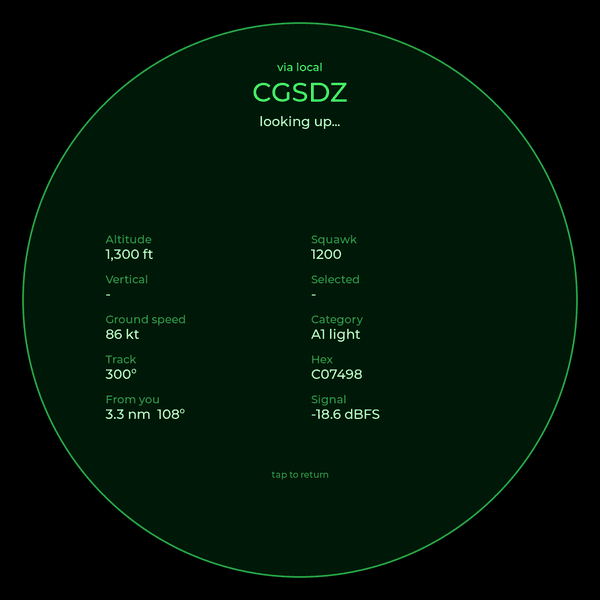
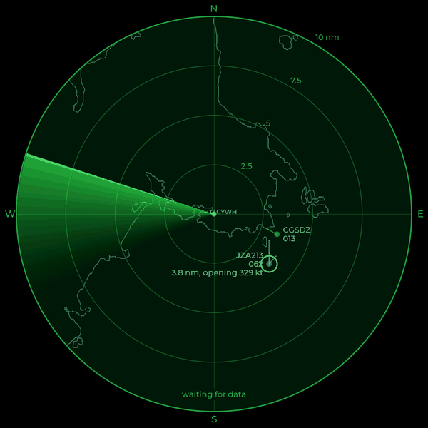
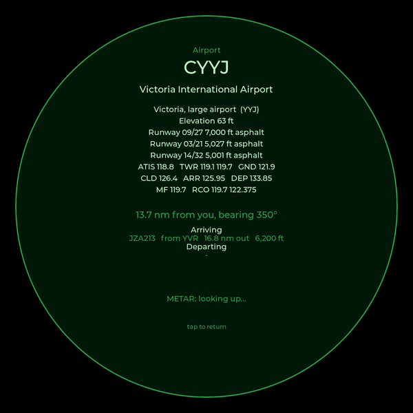
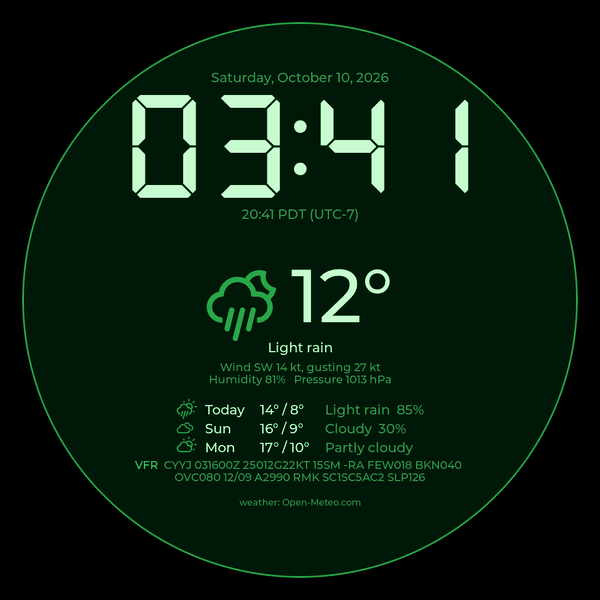
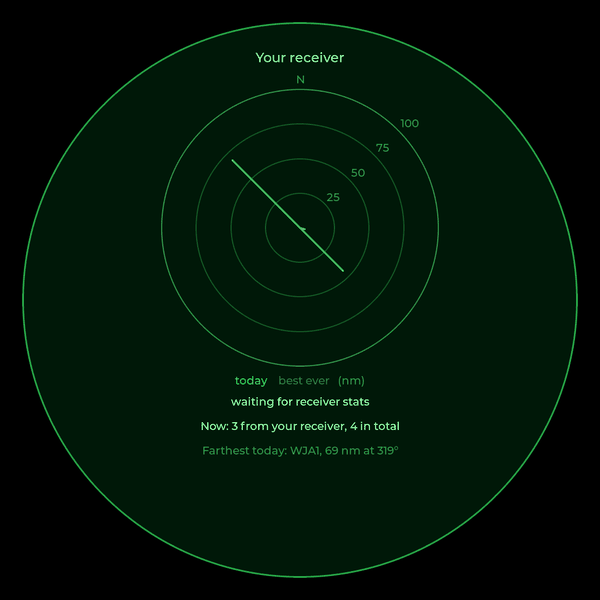
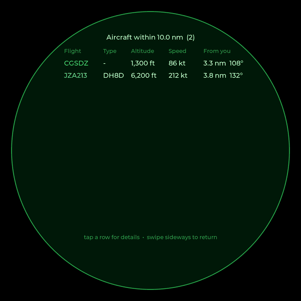
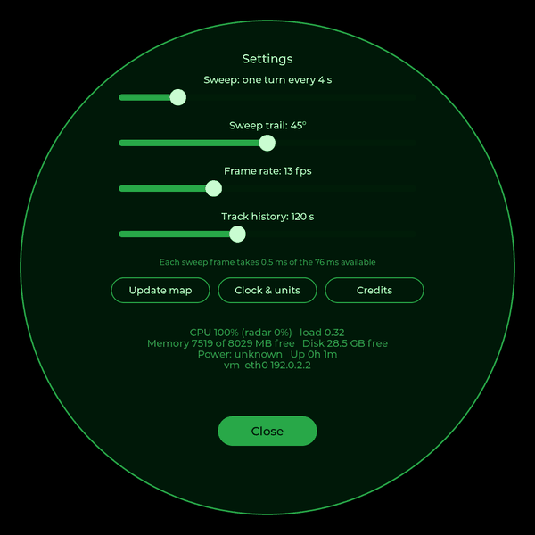
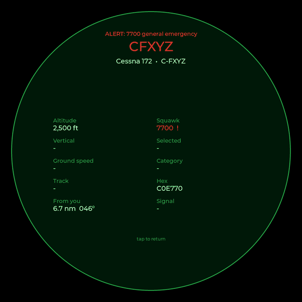

# 7. Touch and screens

## The gestures

| On the radar | Does |
|---|---|
| Tap an aircraft | Its details (swipe between them if several were under your finger) |
| Long-press an aircraft | Follow it; long-press again to stop |
| Tap an airport or navaid | Its information, METAR and live arrivals board |
| Tap empty scope | Next range: 5, 10, 15, 20, 25 nm, then back to 5 |
| Swipe left | Clock and weather |
| Swipe right | Your receiver's stats and range plot |
| Swipe down | List of aircraft in range |
| Swipe up | Settings |

Every other screen goes back to the radar with a tap or a swipe, or by
itself after a while untouched.

## Aircraft details



A tap within 45 pixels of an aircraft opens its details: callsign,
altitude, vertical speed, the altitude set on the autopilot, ground speed
(its speed over the ground, not through the air), track, squawk, category
(light, large, heavy, rotorcraft...), its ICAO address, distance and
bearing from you, and signal strength if your receiver heard it. The
[glossary](13-glossary.md) explains each of these. Type, registration, owner and route are looked up from
adsbdb.com in the background ("looking up...") and filled in when they
arrive.

If two aircraft are close together, both are opened as pages side by side:
swipe between them. The screen goes back to the radar after 20 seconds,
or when you tap it.

## Follow an aircraft



A long-press puts a white ring round an aircraft and a line under it with
its distance from you and whether it's *closing* (getting nearer) or
*opening* (moving away), and how fast.
It's good for watching an arrival come in.

## Airports and navaids



Map points need a closer tap (30 pixels) than aircraft. An airport shows
its name, elevation, runways and radio frequencies from ourairports.com,
its distance and bearing from you, the latest METAR, and a **live board**: aircraft on the radar whose route, from
adsbdb, starts or ends there, with how far out they are.

A navaid shows its identifier, name and type (VOR, VOR-DME,
VORTAC, TACAN, NDB or NDB-DME), its frequency, the DME channel if it has one, its elevation, the
local magnetic variation, and the airport it serves, with its distance and
bearing from you. If your map has towns or peaks, they can be tapped too.

> I wanted real schedules and NOTAMs here, but the sources for those are
> paid or need agreements. The live board is built from what's already on
> the scope.

## Clock and weather



When the radar has been empty for three minutes it shows the clock and
weather instead, and switches back as soon as an aircraft appears. A
swipe left shows it any time.

The big clock shows Zulu (UTC), with local time and the zone underneath;
either can be the big one. Below are the current conditions with an icon,
wind, humidity and pressure, today's high and low, two more days of
forecast, and the METAR for your nearest airport, coloured by its flight
category: green for VFR, blue for MVFR, red for IFR and magenta for LIFR
(roughly: good, marginal, poor and very poor conditions for flying by
sight; the glossary has the details).

**Why Zulu?** Aviation runs on one clock for the whole world, so a flight
plan, a METAR or a controller's instruction means the same time to
everyone, with no time zones or daylight saving to convert. That clock is
Coordinated Universal Time (UTC), the time at the zero meridian through
Greenwich. Time zones have letters, and the zero meridian's is Z, which is
"Zulu" in the phonetic alphabet. A METAR issued at 16:00 UTC says `1600Z`.

## Your receiver



Swipe right for your receiver's health, from dump1090's `stats.json`:
messages per second, signal and noise levels, gain, and the share of
signals strong enough to overload the radio. The plot shows how far away
your receiver has heard aircraft in each 10° direction: today and the
best ever. Hills and buildings show up as dents, so it's a good way to
judge an antenna move.

The plot is saved to `range.txt` every five minutes, so the best ever
survives restarts and reboots (a power cut can lose the last few
minutes). Today's starts afresh at local midnight. The message and signal
figures are live from dump1090 and aren't stored.

## Aircraft list



Swipe down for every aircraft within the current range, nearest first, in
its source's colour. Speeds are ground speeds. Tap a row for its details.

## Settings



Swipe up for sliders that change the radar live: the sweep's speed (2–12
seconds a turn), the trail width (0–90°), the frame rate (5–30 per
second) and the track length (0–5 minutes). Below them, how long each
sweep frame takes, then three buttons:

- **Update map** runs `make_map.py` in the background and redraws the face
- **Clock & units** (chapter 10)
- **Credits**: everyone whose data and code made this possible

At the bottom, the Pi's vital signs: temperature, CPU (all of it, and the
radar's share), memory, disk, power warnings, uptime, IP address (IPv4,
or IPv6 on a network without IPv4), and Wi-Fi network and signal
strength.

## Alerts



When an emergency squawk, a military aircraft or one on your watch list
comes within range, its details open by themselves with a red banner
(chapter 10 has the settings).

## How screens are built

Each screen is an LVGL *screen object*, shown with `lv_screen_load()`.
Most are built once at start-up and their labels updated in place; the
details and map-point screens are built fresh for each tap (the number of
pages varies) and deleted when they close. Swipes are LVGL *gestures*:

```c
lv_obj_add_event_cb(radar_scr, radar_event, LV_EVENT_GESTURE, NULL);
...
lv_dir_t dir = lv_indev_get_gesture_dir(lv_indev_active());
if (dir == LV_DIR_LEFT)
    show(S_WEATHER);
```

## Two touch bugs worth knowing

**The finger that's still down.** A swipe switches screens while the
finger is still on the glass. The new screen then saw a pressed finger and
acted on it: the stats screen closed itself, and settings sliders jumped.
The fix is one line after a gesture changes screens, telling LVGL to
ignore that finger until it lifts:

```c
lv_indev_wait_release(lv_indev_active());
```

**The click after a swipe.** LVGL sends `CLICKED` when a finger lifts, even
at the end of a swipe or a long-press, so a swipe that ended over empty
scope also changed the range. The radar now remembers that the current
touch was a gesture and ignores the click that follows.

## One finger at a time

The screen tracks ten fingers, but LVGL's evdev driver reads only the
first, so pinch-to-zoom and two-finger swipes aren't possible without
writing a multi-touch driver. Everything here is designed for one finger.
