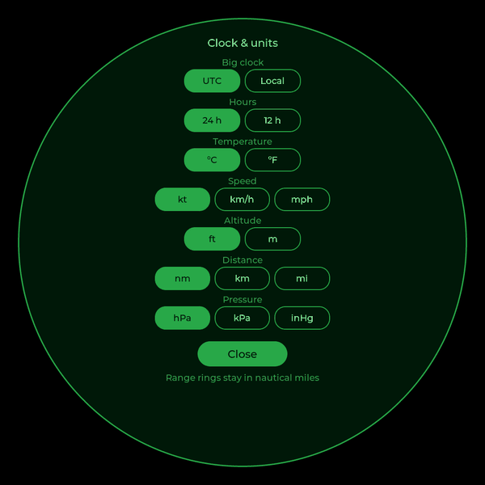

# 10. Settings

## radar.conf

All settings live in `radar.conf`, a plain text file of `key = value`
lines, commented throughout. Comments can go at the end of a line too:

```ini
unit_temp = C           # C or F
```

When you change something on screen (the range, a slider, a unit), the
radar writes it back into `radar.conf` in place, keeping your comments and
layout, so the change survives a restart.

The main groups:

| Settings | What they do |
|---|---|
| `lat`, `lon` | Your receiver's position |
| `range_nm`, `range_min`, `range_max`, `range_step` | The starting range and the steps a tap cycles through |
| `sweep_period_s`, `sweep_trail_deg`, `sweep_fps` | Sweep speed, trail width and frame rate |
| `trail_s` | Seconds of track drawn behind each aircraft |
| `map_file`, `map_options`, `show_*`, `map_*_colour` | The map, what's shown on it, and its colours |
| `detail_timeout_s`, `idle_after_s`, `weather_view_s` | When screens time out |
| `font_file`, `temp_font_file`, `icon_font_file` | Fonts (chapter 8) |
| `clock_main`, `clock_24h`, `unit_*` | Clock and units |
| `metar_station` | The airport whose METAR is on the weather screen |
| `alert_emergency`, `alert_military`, `watch` | Alerts |
| `[source]` sections | Where aircraft come from, how often, and in what colour |
| `fb_dev`, `touch_dev` | The screen and touch devices |

The web addresses for weather, METARs, lookups and receiver stats can be
changed too (`weather_url`, `metar_url`, `lookup_url`, `stats_url`).

## Clock and units



**Settings › Clock & units** has a row of buttons for each:

| | Choices (default first) |
|---|---|
| Big clock | Zulu (UTC), local |
| Hours | 24 h, 12 h |
| Temperature | °C, °F |
| Speed | knots, km/h, mph |
| Altitude | feet, metres |
| Distance | nautical miles, km, statute miles |
| Pressure | hPa, kPa, inHg |

The defaults are aviation's (and Canada's): Zulu (UTC), 24-hour, Celsius, knots,
feet, nautical miles and hectopascals. Altitudes from 18,000 ft up are
shown as flight levels (FL350) as pilots say them. The range rings always
stay in nautical miles.

## Alerts

Three kinds of aircraft can open their details by themselves when they
come within range:

- **Emergencies**: squawk 7500, 7600 or 7700 (`alert_emergency = yes`)
- **Military** aircraft, as flagged by adsb.fi (`alert_military = yes`)
- **Your watch list**:

```ini
watch = C-FTCA, RCH*, C130, A7615F
```

Entries can be a registration, a callsign, an ICAO type or an ICAO
address, in any case, with or without dashes. A `*` at the end matches the
start, so `RCH*` catches every US Air Force "Reach" flight. Each aircraft
alerts at most once every half hour.
