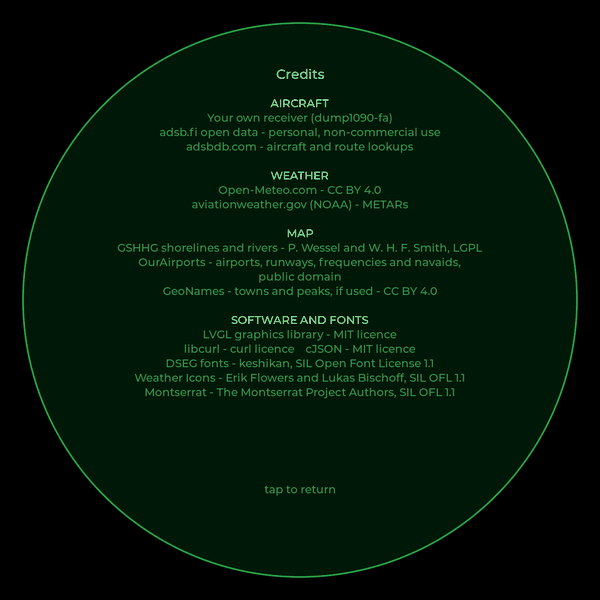

# 12. Credits, lessons and ideas

## Credits

**Data**

- [adsb.fi](https://adsb.fi): open aircraft data from volunteer feeders,
  for personal, non-commercial use
- [adsbdb.com](https://www.adsbdb.com): aircraft and route lookups
- [Open-Meteo](https://open-meteo.com): weather, CC BY 4.0
- [aviationweather.gov](https://aviationweather.gov) (NOAA): METARs
- [GSHHG](https://www.soest.hawaii.edu/pwessel/gshhg/): shorelines and
  rivers, by P. Wessel and W. H. F. Smith, LGPL
- [OurAirports](https://ourairports.com): airports, runways, frequencies and
  navaids, public domain
- [GeoNames](https://www.geonames.org): towns and peaks, CC BY 4.0

**Software and fonts**

- [LVGL](https://lvgl.io): MIT licence
- [libcurl](https://curl.se): curl licence
- [cJSON](https://github.com/DaveGamble/cJSON): MIT licence
- [DSEG fonts](https://www.keshikan.net/fonts-e.html) by keshikan: SIL OFL 1.1
- [Weather Icons](https://erikflowers.github.io/weather-icons/) by Erik
  Flowers and Lukas Bischoff: SIL OFL 1.1
- Montserrat, by the Montserrat Project Authors: SIL OFL 1.1

The code in this repository is BSD 2-Clause licensed.

## Lessons learned

- **Check the cable.** A blank screen was a half-seated mini-HDMI plug.
- **`video=` in cmdline.txt**, not `hdmi_*` in config.txt, sets the mode
  with today's graphics driver.
- **Rebuild from clean when things make no sense.** Once, after big
  changes, aircraft refused to blink and tracks wouldn't draw. An old build
  was being run. `rm -rf build` and building again fixed it.
- **Programs started over SSH die with the session.** Use a service.
- **Keep LVGL on one thread.** Worker threads fetch; the main thread draws.
- **Gestures need care**: wait for the finger to lift after switching
  screens, and ignore the click that ends a swipe.
- **Read error messages sceptically.** "cache not allocated" meant "this
  font has no letter T".
- **Old guides and new versions.** LVGL 9 renamed its CMake options, and the
  old names were silently ignored, so LVGL's examples and demos were being
  built too. Check the version a guide was written for.
- **Data comes with terms.** Every free service here asks for a credit and
  light use. It's easy to honour, and it keeps them free.

## Ideas for next time

- **Weather alerts**: Environment Canada publishes alerts as open data; a
  coloured ring around the scope could show a warning in effect.
- **Pinch to zoom**: needs a multi-touch input driver, since LVGL's evdev
  driver reads one finger.
- **A bigger Pi**: on a Pi 4 or 5, a higher frame rate and smoother sweep.
- **Other screens**: anything with a framebuffer works, from little SPI
  panels on `/dev/fb1` to large HDMI monitors. Only the layout assumes a
  1080-pixel circle.
- **Other data**: AIS for ships, APRS for radio amateurs, or lightning
  strikes, all could be plotted on the same scope.

## Thanks

To the Raspberry Pi meetup for listening, to everyone who feeds adsb.fi,
and to the people behind every library, font and data set listed above.
