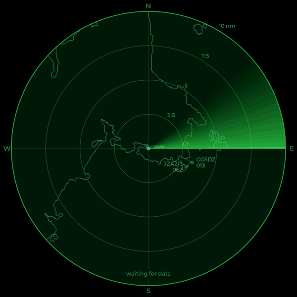

# A radar for your own sky

**LVGL on a Raspberry Pi framebuffer: from "touch the screen" to a live
ADS-B radar display, with no X or Wayland.**

Gordon M. Celesta · Victoria, BC · Raspberry Pi meetup, October 2026

This is the write-up for my talk. It's meant to be followed along with during
the Meetup, and to be enough to build your own afterwards. The code is at
[github.com/va7sdf/lvgl-radar](https://github.com/va7sdf/lvgl-radar).

There are two projects in it:

- **The touch demo**, about 200 lines of C. It puts a picture on a screen
  and reads touches with no desktop at all. It's the "hello, world" for
  any screen on a Pi, round, square or a little SPI panel.
- **The radar**, which plots the aircraft my receiver hears as if on an old
  radar scope. The sweep turns with a phosphor glow, aircraft move only as
  it passes, and the coastline of southern Vancouver Island glows
  underneath. Touch an aircraft and you get its details; swipe for
  weather, receiver stats, a list and settings.

## Contents

1. [Why skip the desktop?](01-framebuffer.md) The framebuffer, evdev and LVGL
2. [The hardware](02-hardware.md) Parts, setting up the screen and finding the touch panel
3. [The touch demo, step by step](03-touch-demo.md) Build it and walk through the code
4. [Building the radar](04-radar-setup.md) From a fresh SD card to a running radar
5. [How the radar works](05-how-it-works.md) Data flow, threads, the sweep and the tracks
6. [The map](06-map.md) Shorelines, rivers, airports and navaids for your location
7. [Touch and screens](07-screens.md) Every gesture and screen, and two touch bugs worth knowing
8. [Fonts and icons](08-fonts.md) TrueType at runtime, a seven-segment clock and weather icons
9. [Where the data comes from](09-data-sources.md) The receiver and five free web services
10. [Settings](10-settings.md) radar.conf, units and alerts
11. [Running it for real](11-running.md) A service, taking it out, and showing it on a projector
12. [Credits, lessons and ideas](12-credits.md)
13. [Glossary](13-glossary.md) The aviation and computing terms used here

## In one minute

| | |
|---|---|
| Computer | Raspberry Pi Zero 2 W, Raspberry Pi OS Lite (64-bit), no desktop |
| Screen | Waveshare 5" round, 1080 × 1080, HDMI, 10-point USB touch |
| Graphics | [LVGL](https://lvgl.io) 9.3 drawing straight to `/dev/fb0` |
| Touch | Linux evdev, through LVGL's driver |
| Language | C (the touch demo); C and a little Python (the radar's tools) |
| Aircraft | My own dump1090-fa receiver, plus the adsb.fi open data feed |
| Network | IPv4 or IPv6 (chapter 9 has the details) |
| Licence | BSD 2-Clause; fonts and data keep their own licences |
